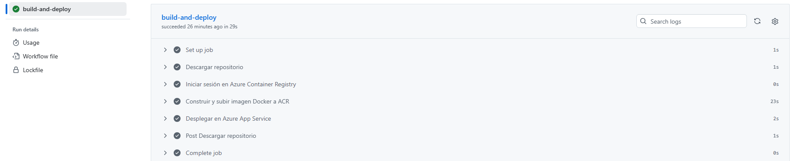
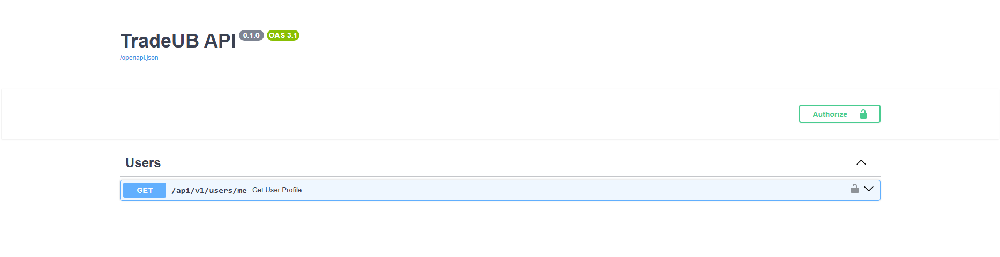

# Execució i validació en local

## Backend (Python / FastAPI)

### 1. Configurar les variables d'entorn
Crear el fitxer `backend/.env` prenent com a base el fitxer `backend/.env.example`.

### 2. Instal·lar les dependències
```bash
cd backend
pip install -r requirements.txt
```

### 3. Validacions abans de fer un Pull Request

**Validar i corregir l'estil i la sintaxi del codi (Ruff):**

```bash
# Comprovar si hi ha errors d'estil o sintaxi
python -m ruff check .

# Corregir automàticament els errors que es puguin resoldre
python -m ruff check --fix .
```

**Executar els tests unitaris:**

```bash
pytest
```
Si falla: `.\.venv\Scripts\python.exe -m pytest`

**Validar manualment, per desplegar el backend**:
```bash
uvicorn main:app --reload
```
Si falla: `python -m uvicorn main:app --reload`


## Frontend (Vue 3 / Vite)

### 1. Configurar les variables d'entorn

Crear el fitxer `frontend/.env` prenent com a base el fitxer `frontend/.env.example`.

### 2. Instal·lar les dependències

```bash
cd frontend
npm ci
```

### 3. Validacions abans de fer una Pull Request

**Validar i corregir l'estil del codi (ESLint):**

```bash
# Comprova si hi ha errors d'estil
npm run lint

# Corregeix automàticament els problemes d'estil que es puguin resoldre
npx eslint . --fix
```

**Verificar que l'aplicació compila correctament:**

```bash
npm run build
```

**Executar els tests unitaris:**

```bash
npm test
```

**Validar manualment, per desplegar el frontend**:
```bash
npm run dev
```

## Abans de fer `git push`

Cal comprovar el següent:

* S'han configurat els fitxers `.env` a partir dels fitxers `.env.example`.
* El backend supera les comprovacions de Ruff (`python -m ruff check .`).
* Els tests del backend passen amb `pytest`.
* El frontend supera les comprovacions d'ESLint (`npm run lint`).
* El frontend es compila correctament amb `npm run build`.
* Els tests del frontend passen amb `npm test`.

**Important:** Cal executar les ordres de cada secció dins del directori corresponent (`/backend` o `/frontend`).

## Després de fer PR cap a `develop` o `main` (Backend)

Un cop la Pull Request d'una feature (p.ex. `feature/US1.1`) s'hagi aprovat i s'hagi fet el *merge* cap a `develop` o `main`, cal provar el desplegament del backend al núvol seguint aquests passos:

### 1. Desplegament automàtic a GitHub
En fer el *merge* de la Pull Request a les branques `develop` o `main`, s'activarà automàticament el pipeline de CI/CD a GitHub Actions per construir i desplegar la nova versió.

### 2. Supervisar el workflow a GitHub Actions
Ves al repositori a GitHub i entra a la pestanya **Actions**.
Espera que tots els passos de les GitHub Actions (construcció de la imatge Docker i desplegament a Azure App Service) finalitzin amb un tic.



### 3. Verificar l'API a producció
Obre el navegador i accedeix a la documentació a la URL pública assignada per Azure:

[https://apptradeub-ceaje7dhhrdzgmc0.francecentral-01.azurewebsites.net/docs](https://apptradeub-ceaje7dhhrdzgmc0.francecentral-01.azurewebsites.net/docs)



Si la pàgina carrega correctament i mostra tots els endpoints (com `/api/v1/users`), el desplegament del backend ha estat un èxit i està llest per rebre peticions del frontend.

## Treball amb agents de codi

Les instruccions i plantilles del projecte per treballar amb agents de codi són a:

- [`AGENTS.md`](AGENTS.md): normes generals de codi, arquitectura, seguretat i
  validació.
- [`.github/copilot-instructions.md`](.github/copilot-instructions.md):
  instruccions que VS Code aplica al xat i al mode Agent.
- [`.github/skills/`](.github/skills/): procediments reutilitzables de
  validació i sistema visual.
- [`.github/agents/`](.github/agents/): perfils de backend, frontend i revisió.
- [`docs/agents/`](docs/agents/): especificació de tasques, matriu de
  delegació, Definition of Done, revisió, seguiment, Sprint Review,
  retrospectiva, Sprint 0 i registre acumulatiu.

Abans d'acceptar canvis generats per un agent, revisa sempre el diff i executa
les validacions indicades a `AGENTS.md`. 